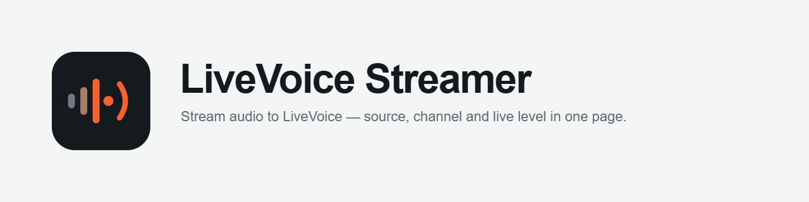
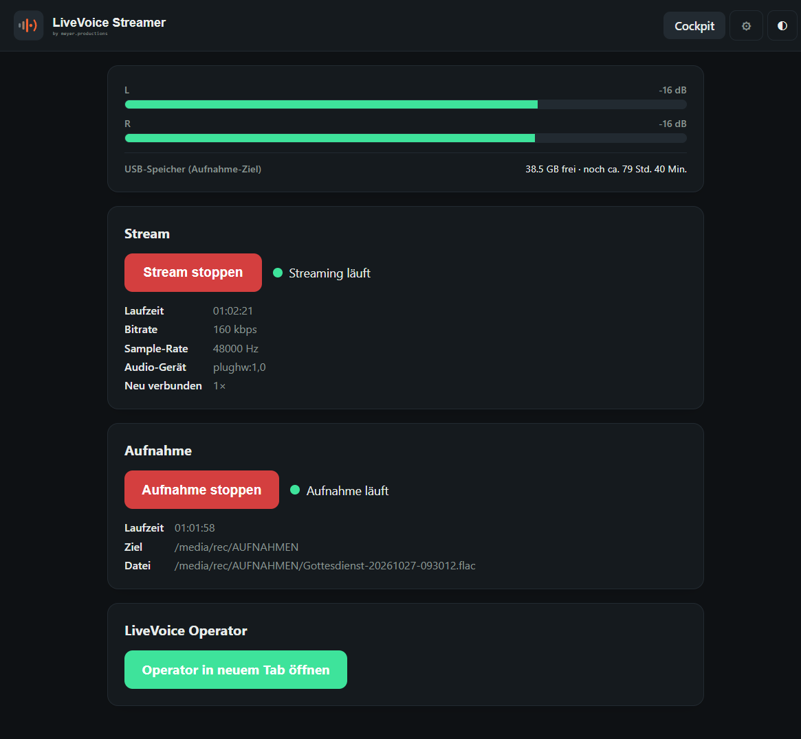
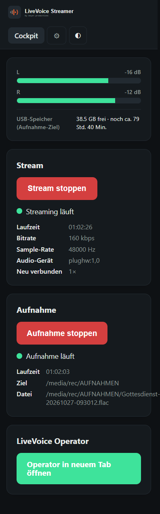
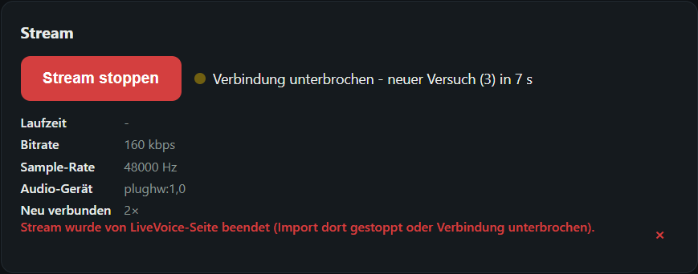
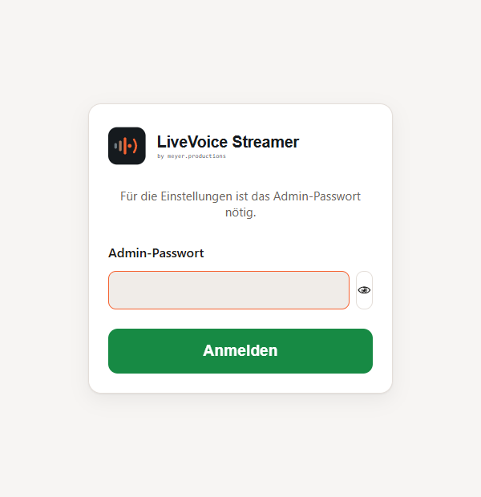
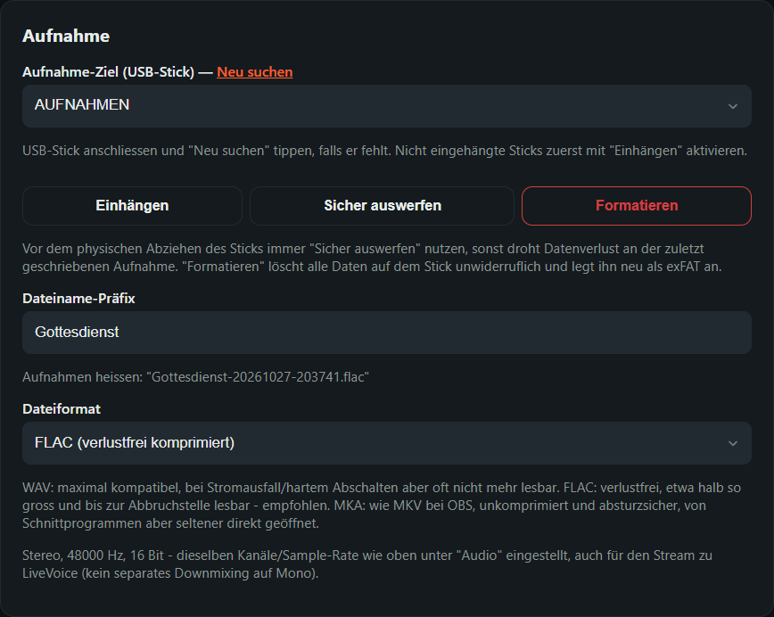
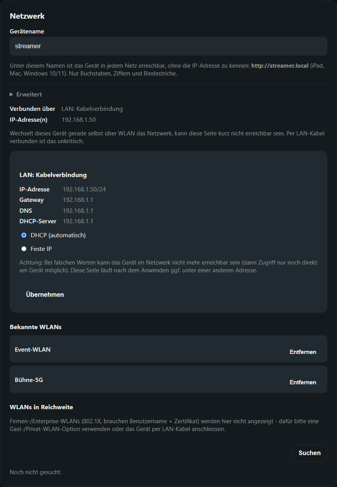
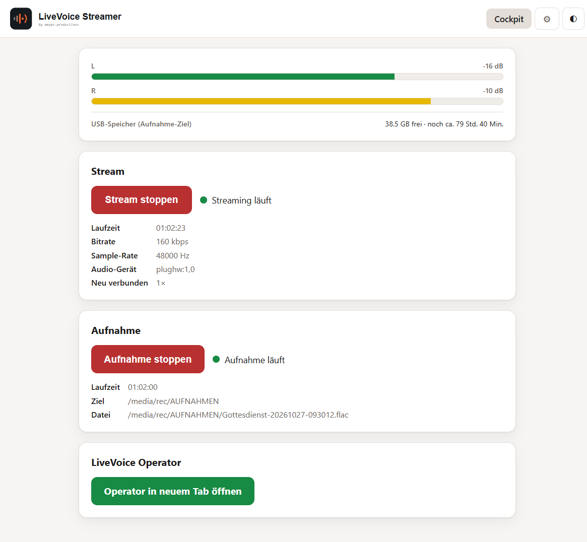
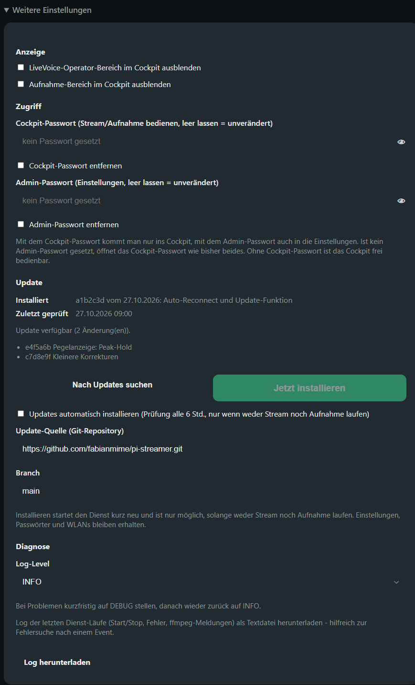
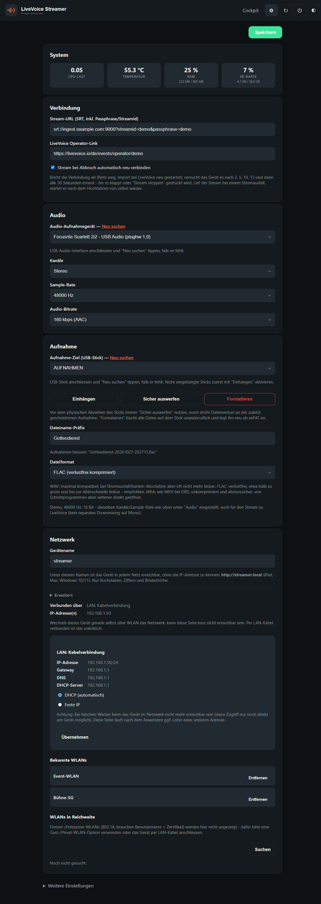

<picture>
  <source media="(prefers-color-scheme: dark)" srcset="docs/brand/banner-dark-1280x320.png">
  
</picture>

<p align="center">
  
  
  
  
</p>

**Ein Raspberry Pi als eigenständiger Audio-Sender für [LiveVoice](https://livevoice.io).**
USB-Audio-Interface anschliessen, Stream-URL eintragen, auf «Stream starten» tippen –
das Signal geht per SRT direkt zu LiveVoice. Ohne Laptop, ohne OBS, bedienbar vom
iPad oder Smartphone. Parallel zeichnet das Gerät verlustfrei auf einen USB-Stick auf.

<p align="center">
  
  &nbsp;
  
</p>

## Funktionen

**Streamen**
- USB-Audio → ffmpeg (AAC in MPEG-TS) → SRT → LiveVoice-Import, 96–256 kbps, 44,1/48 kHz, Mono oder Stereo
- **Automatisches Neuverbinden:** Bricht die Verbindung ab (Netz weg, Import bei LiveVoice neu gestartet), versucht es das Gerät nach 2, 5, 10, 15 und dann alle 30 Sekunden erneut – bis es klappt. Lief der Stream bei einem Stromausfall, startet er nach dem Hochfahren von selbst wieder.
- Verständliche Meldungen statt ffmpeg-Log, z. B. «Import bei LiveVoice noch nicht gestartet»
- Link zum LiveVoice-Operator direkt im Cockpit

**Aufnehmen**
- Parallele, verlustfreie Aufnahme auf USB-Stick – unabhängig vom Stream start- und stoppbar
- Format wählbar: **WAV**, **FLAC** (empfohlen) oder **MKA** – siehe [Aufnahmeformate](#aufnahmeformate)
- Stick erkennen, einhängen, sicher auswerfen und formatieren (exFAT) direkt im WebUI
- Freier Speicher und geschätzte Restlaufzeit im Cockpit, mit Warnfarbe

**Bedienung & Betrieb**
- Pegelanzeige L/R, läuft immer mit – auch während Stream und Aufnahme
- Touch-optimiert für iPad und Smartphone, Hell-/Dunkelmodus, «Zum Home-Bildschirm»
- Operator- und Aufnahme-Bereich bei Bedarf ausblendbar
- **Zwei Passwortstufen:** Cockpit-Passwort für die Bedienung, Admin-Passwort für die Einstellungen
- **Gerätename frei wählbar** – erreichbar als `http://<name>.local`, ohne die IP zu kennen
- WLAN suchen und verbinden, DHCP oder feste IP – alles im WebUI, kein SSH nötig
- Audio-Interface wechseln per «Neu suchen» – das Gerät wird über seine feste Kennung wiedererkannt
- **Updates per Knopfdruck** direkt aus diesem Repository (optional automatisch)
- Systemanzeige (CPU, Temperatur, RAM, SD-Karte), Neustart/Herunterfahren, Log-Download

## Screenshots

| Verbindung unterbrochen – automatischer Neuversuch | Admin-Anmeldung |
| --- | --- |
|  |  |

| Aufnahme-Einstellungen | Netzwerk & Gerätename |
| --- | --- |
|  |  |

<details>
<summary>Weitere Screenshots</summary>

**Cockpit im Hellmodus**



**Weitere Einstellungen: Anzeige, Zugriff, Update, Diagnose**



**Einstellungen komplett**



</details>

<sub>Screenshots mit Beispieldaten aus [`tools/demo_server.py`](tools/demo_server.py).</sub>

## Was du brauchst

- Raspberry Pi 3 Model B oder neuer mit Raspberry Pi OS Lite (64 Bit, Debian 13 «trixie») –
  entwickelt und im Einsatz auf einem Pi 3 Model B
- USB-Audio-Interface, das unter Linux ohne Treiber läuft (USB Audio Class) – getestet mit einem Focusrite-Interface
- Netzwerk per LAN oder WLAN mit Internetzugang
- Optional: USB-Stick für Aufnahmen
- Ein LiveVoice-Event mit aktiviertem SRT-Import (Stream-URL inkl. Passphrase aus dem LiveVoice-Dashboard)

## Installation

Die vollständige Schritt-für-Schritt-Anleitung steht in **[DEPLOY.md](DEPLOY.md)**. Kurzfassung:

1. Raspberry Pi OS Lite flashen, SSH aktivieren
2. Pakete installieren: `ffmpeg python3-venv alsa-utils git avahi-daemon`
3. Dienstbenutzer `rec` anlegen, dieses Repository nach `/opt/livevoice-streamer` klonen, Python-venv einrichten
4. ALSA-Freigabe sowie Polkit-Regeln (WLAN, USB-Sticks, Power, Gerätename) aus `systemd/` installieren
5. systemd-Dienst `livevoice-streamer` aktivieren
6. `http://<pi>/` im Browser öffnen und die Einstellungen ausfüllen

## Bedienung

1. **Einstellungen** (Zahnrad): Stream-URL aus LiveVoice eintragen, Audio-Gerät wählen, speichern.
2. Bei LiveVoice den **Import starten** (Operator oder Dashboard).
3. Im **Cockpit** auf «Stream starten» tippen – der Pegel zeigt, ob Signal ankommt.
4. Optional «Aufnahme starten» für die Sicherung auf dem USB-Stick.
5. Nach dem Event: Stream und Aufnahme stoppen, Stick «sicher auswerfen», Gerät über ⏻ herunterfahren.

## Aufnahmeformate

| Format | Inhalt | Empfehlung |
| --- | --- | --- |
| **WAV** | unkomprimiert, 16 Bit (ab 4 GB automatisch RF64) | maximale Kompatibilität, aber nach Stromausfall oft nicht mehr lesbar |
| **FLAC** | verlustfrei komprimiert, etwa halb so gross | **empfohlen** – bleibt nach Stromausfall bis zur Abbruchstelle lesbar |
| **MKA** | unkomprimiert in Matroska | das Audio-Gegenstück zu MKV bei OBS – absturzsicher, von Schnittprogrammen seltener direkt geöffnet |

Kanäle und Sample-Rate gelten für Stream und Aufnahme gleichermassen.

## Updates

Unter **Einstellungen → Weitere Einstellungen → Update** prüft das Gerät dieses Repository
auf neue Versionen und installiert sie per Knopfdruck. Einstellungen, Passwörter und WLANs
bleiben erhalten. Ein Update ist nur möglich, solange weder Stream noch Aufnahme laufen.
Schlägt die Installation fehl, kehrt das Gerät zum vorherigen Stand zurück.
Wahlweise installiert es Updates automatisch (Prüfung alle 6 Stunden, nur im Leerlauf).

## Sicherheit

- Das WebUI läuft über **HTTP ohne Verschlüsselung** und ist für das lokale Event-Netz
  gedacht, nicht für das offene Internet.
- An Events mit fremden Leuten im selben Netz: **Admin-Passwort setzen**, bei Bedarf
  zusätzlich ein Cockpit-Passwort.
- Die Konfiguration (inkl. Stream-URL und Passphrase) liegt nur auf dem Gerät
  (`instance/config.json`) und wird nirgends hin übertragen.
- Der Dienst läuft als eigener Systembenutzer ohne Login-Shell; die nötigen Rechte
  (WLAN, USB, Power, Gerätename) sind per Polkit gezielt auf diesen Benutzer beschränkt.

## Entwicklung

```sh
python -m venv .venv && . .venv/bin/activate
pip install -r requirements-dev.txt
pytest                                   # ~300 Tests, ohne Hardware lauffähig
python tools/demo_server.py --port 8099  # WebUI mit Beispieldaten
```

Architektur, Designentscheide und Hintergründe: **[docs/TECHNIK.md](docs/TECHNIK.md)**.

## Hinweis

«LiveVoice» und das LiveVoice-Logo sind Marken der LiveVoice GmbH. Dieses Projekt ist ein
unabhängiges Community-Werkzeug, steht in keiner Verbindung zu LiveVoice und verwendet
weder deren Logo noch deren Wortmarke als Produktname. Es werden keine Zugangsdaten,
Audio- oder Event-Daten an Dritte übertragen – das Audio geht ausschliesslich an die von
dir eingetragene Stream-URL.

## Lizenz

© 2026 [meyer.productions](https://meyer.productions) – veröffentlicht unter der [MIT-Lizenz](LICENSE).

Du darfst die Software frei nutzen, verändern und weitergeben, auch kommerziell,
solange der Copyright-Hinweis und der Lizenztext erhalten bleiben. Die Software
wird ohne Gewähr bereitgestellt. Die Marken- und Logo-Rechte am LiveVoice-Streamer-Design
(`app/static/brand/`, `docs/brand/`) bleiben bei meyer.productions.
